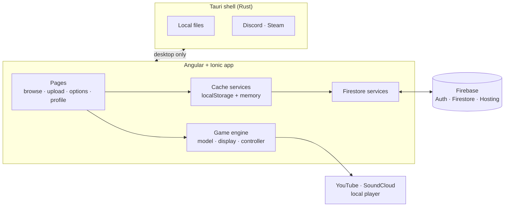

<div align="center">


**A StepMania-style rhythm game engine, rebuilt from scratch for the web browser and the desktop.**

[](https://dance-corp.web.app)

[](https://github.com/Fx73/Dance-Corp/actions/workflows/deploy.yml)
[](https://github.com/Fx73/Dance-Corp/commits)
[](https://deepscan.io/dashboard#view=project&tid=17167&pid=27278&bid=870516)


[**▶ Play in your browser**](https://dance-corp.web.app) · [Report a bug](https://github.com/Fx73/Dance-Corp/issues) · [Known issues](Documentation/KNOWN_ISSUES.md) · [Missing features](Documentation/MISSING_FEATURES.md)

</div>

---

## Table of contents

- [About](#-about)
- [Highlights](#-highlights)
- [Feature status](#-feature-status)
- [Gameplay](#-gameplay)
- [Chart files](#-chart-files)
- [Architecture](#%EF%B8%8F-architecture)
- [Getting started](#-getting-started)
- [CI/CD and environments](#-cicd-and-environments)
- [Contributing](#-contributing)
- [Credits](#-credits)

---

## 🎵 About

Dance Corp recreates the StepMania / DDR experience with a rhythm game engine written from scratch in TypeScript. It aims at the same precise timing, a balanced scoring system and the feedback players expect from the original, while the web brings what a desktop game cannot: an online song catalog, chart sharing between players, and nothing to install.

Songs are never hosted: they are streamed from **YouTube** or **SoundCloud**. The **desktop version** (Tauri) can also play songs stored on your computer, which never leave your device.

## ✨ Highlights

| | |
|---|---|
| 🎯 **Precise engine** | BPM changes and stops on a beat timeline, judgment windows measured in seconds, not frames. |
| 👥 **Local multiplayer** | Up to **4 players** on the same screen, each with their own pad, chart and difficulty. |
| 🎮 **Any controller** | Dance pads and gamepads through the Gamepad API, or the keyboard, with full key binding and a pad test page. |
| 🌐 **Online catalog** | Browse the community catalog, upload your own `.sm` / `.ssc` charts, keep your high scores per chart. |
| 📊 **Difficulty radar** | Every chart is analyzed on upload and scored on 5 criteria: endurance, speed, technical, burst and chaos. |
| 📣 **Announcers** | Voiced announcers and a crowd that react to your combo and your performance. |
| 🖥️ **Desktop app** | Tauri build with local songs, **Discord** Rich Presence and **Steam** integration. |

## 📌 Feature status

### Notes

| Feature | Status | Notes |
|---|:---:|---|
| Tap notes | ✅ | |
| Hold notes | ✅ | |
| Mines | ✅ | |
| Roll notes | 🟡 | Played as holds |
| Minefields, fakes, hidden notes | ❌ | Read from the file, not played yet |

### Timing and effects

| Feature | Status | Notes |
|---|:---:|---|
| BPM changes | ✅ | |
| Stops | ✅ | |
| Background changes | ✅ | |
| Warps | ❌ | Read from the file, not applied yet |
| Speed and scroll changes | ❌ | Read from the file, not applied yet |
| Per-chart `#OFFSET` (SSC split timing) | ❌ | [High priority](Documentation/MISSING_FEATURES.md) |

### Game modes

| Feature | Status |
|---|:---:|
| Dance Single (4 panels) | ✅ |
| Dance Double (8 panels) | ✅ |
| Local multiplayer, up to 4 players | ✅ |
| Training mode (no fail) | ✅ |

### Score and progression

| Feature | Status | Notes |
|---|:---:|---|
| 1,000,000-point scoring | ✅ | Spread exactly across the chart's notes |
| Combo tracking | ✅ | Does not count in the score yet |
| Grades (S to E) | ✅ | |
| High scores per chart | ✅ | Saved to your account |
| Leaderboards | ❌ | |
| Titles and achievement badges | ❌ | [Low priority](Documentation/MISSING_FEATURES.md) |

### Platform

| Feature | Status |
|---|:---:|
| Gamepad and keyboard mapping, pad test | ✅ |
| Display size and bar display options | ✅ |
| Separate volumes: music, menu music, announcers, effects | ✅ |
| Accounts: email, Google, Facebook | ✅ |
| Chart upload and editing | ✅ |
| YouTube and SoundCloud streaming | ✅ |
| Local songs (desktop) | ✅ |
| Discord and Steam presence (desktop) | ✅ |

## 🕹️ Gameplay

### Judgment and score

Every chart is worth exactly **1,000,000 points**, divided between its taps and holds. Mines never add to the score, but hitting one costs a lot of life.

| Judgment | Score of the note | Life |
|---|:---:|:---:|
| **Perfect** | 100 % | +2 |
| **Great** | 80 % | +1 |
| **Good** | 60 % | +1 |
| **Almost** | 20 % | −3 |
| **Missed** | 0 % | −4 |
| **Mine hit** | — | −20 |

The life gauge starts at 50 out of 100. When it runs out, the song is failed, unless training mode is on.

### Grades

| Grade | S | AAA | AA | A | B | C | D | E |
|---|:---:|:---:|:---:|:---:|:---:|:---:|:---:|:---:|
| **Score** | 1,000,000 | 980,000 | 950,000 | 900,000 | 800,000 | 700,000 | 600,000 | below, or failed |

### Difficulty radar

On upload, each chart goes through an evaluator that measures its steps, jumps, holds, mines, off-beat notes and BPM, and turns them into 5 criteria drawn as a radar:

- **Endurance**: sustained effort over the whole song
- **Speed**: how fast the notes come
- **Technical**: variety of steps and patterns
- **Burst**: complexity of the most intense sections
- **Chaos**: how unpredictable the chart is

## 📁 Chart files

The reader accepts StepMania **`.sm`** and **`.ssc`** files. It converts them to **`.essc`** (extended SSC): an SSC file stripped of the fields the game does not use, where every note type is written as a digit.

| Digit | Note | In the original file |
|:---:|---|:---:|
| `0` | No note | `0` |
| `1` | Tap | `1` |
| `2` | Hold head | `2` |
| `3` | Hold, roll or minefield end | `3` |
| `4` | Roll head | `4` |
| `5` | Mine | `M` |
| `6` | Minefield head | `N` |
| `7` | Fake | `F` |
| `8` | Hidden | `H` |

Difficulty names are normalized to five levels: **Beginner**, **Easy**, **Advanced**, **Expert** and **Challenge**.

## 🏗️ Architecture



### The game engine

The engine follows an **MVC pattern**, with one instance of each part per player:

- **Model**: `GameRound` is the main game loop. It judges each arrow, keeps the score, the combo and the life gauge. `ArrowManager` builds the notes from the chart, and `BeatManager` converts time to beats through BPM changes and stops.
- **View**: `PlayerDisplayComponent` draws the arrows, the bars and the HUD on a canvas.
- **Controller**: an `IDancePad` implementation, for a gamepad or the keyboard.

A single `GameManager` runs the rounds, and a single `IMusicPlayer` plays the song, from YouTube, SoundCloud or a local file.

### Data layers

Pages never talk to Firestore directly: **Firestore service** (remote access) → **cache service** (localStorage and memory) → **page**. Firestore rules and indexes are versioned in [website/](website/) and deployed by the CI.

### Project structure

```
src/app/
├── game/            Game engine: model, display, controllers, music players
├── pages/           Welcome, browse, upload, options, player selection, profile, about
├── services/        Firestore, local cache, gamepad, sounds and announcers, presence
└── shared/          Header, guards, login, grade and radar components, utilities
src-tauri/           Desktop shell in Rust: local files, Discord, Steam
website/             Firebase Hosting config, Firestore rules and indexes
tools/               Maintenance scripts for the database
Documentation/       Known issues, missing features, changes to verify
```

## 🚀 Getting started

### Requirements

- [Node.js](https://nodejs.org/) 24 and npm
- The [Ionic CLI](https://ionicframework.com/docs/cli): `npm install -g @ionic/cli`
- For the desktop app: [Rust](https://www.rust-lang.org/tools/install) and the [Tauri prerequisites](https://tauri.app/start/prerequisites/)

### Web

```bash
npm install
ionic serve          # http://localhost:8100, on the dev Firebase project
```

### Desktop

```bash
npx tauri dev        # starts ionic serve and opens the desktop window
npx tauri build      # builds the installers
```

### Useful commands

| Command | Description |
|---|---|
| `npm run lint` | Run ESLint on the project |
| `npm run build` | Build the web app |
| `npm run reinstall` | Delete `node_modules` and the lock file, then reinstall |

## 🔄 CI/CD and environments

Two Firebase projects keep production apart from development:

| | Development | Production |
|---|---|---|
| **Firebase project** | `dance-corp-dev` | `dance-corp` |
| **Used by** | `ionic serve`, `tauri dev`, the `dev` branch, PR previews | the `master` branch |

GitHub Actions handle the whole pipeline:

- **Pull requests**: lint, web build, desktop build, and a Firebase preview channel for 7 days.
- **Push on `dev`**: patch version bump, then deployment to the dev project.
- **Pull request `dev` → `master`**: minor version bump.
- **Push on `master`**: deployment to production and a `vX.Y.Z` release tag.

Firestore rules and indexes are deployed with the app, so they never drift from the code.

## 🤝 Contributing

- `master` only holds released versions and is updated through pull requests from `dev`.
- Features start from `dev` on their own branch, and come back to `dev` through a pull request.
- Lint and build must pass before any commit.
- Code style, naming and layering rules are described in [CLAUDE.md](CLAUDE.md).

The [Documentation](Documentation/) folder tracks the project's state:

- [KNOWN_ISSUES.md](Documentation/KNOWN_ISSUES.md): bugs found and not fixed yet
- [MISSING_FEATURES.md](Documentation/MISSING_FEATURES.md): what the engine does not support yet
- [TO_VERIFY.md](Documentation/TO_VERIFY.md): changes waiting for a manual check

## 🙏 Credits

- All visual assets are made by the author or come from free-to-use resources.
- Announcer voices (CC-BY): **Aimee Smith** (female announcers) and **VoiceBosch** (male announcer).
- Inspired by [StepMania](https://www.stepmania.com/) and Dance Dance Revolution.

<div align="center">

Have an idea or found a bug? [Open an issue](https://github.com/Fx73/Dance-Corp/issues).

</div>
