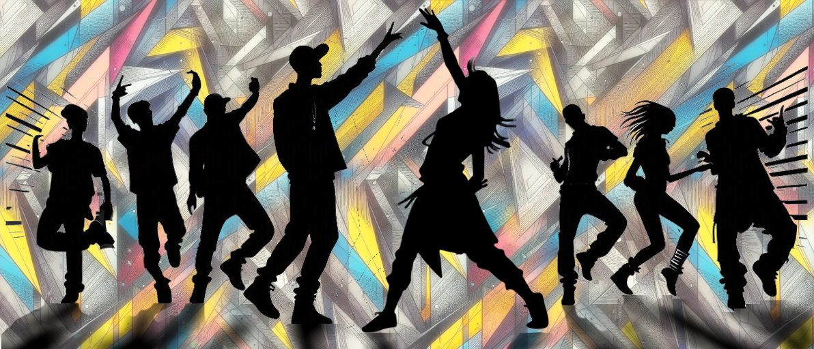

<div align="center">



**A StepMania-style rhythm game engine, rebuilt from scratch for the web browser and the desktop.**

[](https://dance-corp.web.app)

[](https://github.com/Fx73/Dance-Corp/actions/workflows/deploy.yml)
[](https://github.com/Fx73/Dance-Corp/commits)
[](https://deepscan.io/dashboard#view=project&tid=17167&pid=27278&bid=870516)


[**▶ Play in your browser**](https://dance-corp.web.app) · [Wiki](https://github.com/Fx73/Dance-Corp/wiki) · [Report a bug](https://github.com/Fx73/Dance-Corp/issues)

</div>

---

## 🎵 About

Dance Corp recreates the StepMania / DDR experience with a rhythm game engine written from scratch in TypeScript. It aims at the same precise timing, a balanced scoring system and the feedback players expect from the original, while the web brings what a desktop game cannot: an online song catalog, chart sharing between players, and nothing to install.

Songs are never hosted: they are streamed from **YouTube** or **SoundCloud**. The **desktop version** (Tauri) can also play songs stored on your computer, which never leave your device.

## ✨ Highlights

| | |
|---|---|
| 🎯 **Precise engine** | BPM changes and stops on a beat timeline, judgment windows measured in seconds, not frames. |
| 👥 **Local multiplayer** | Up to **4 players** on the same screen, each with their own pad, chart and difficulty. |
| 🎮 **Any controller** | Dance pads and gamepads through the Gamepad API, or the keyboard, with full key binding and a pad test page. |
| 🌐 **Online catalog** | Browse the community catalog, upload your own `.sm` / `.ssc` charts, keep your high scores per chart. |
| 📊 **Difficulty radar** | Every chart is analyzed on upload and scored on 5 criteria: endurance, speed, technical, burst and chaos. |
| 📣 **Announcers** | Voiced announcers and a crowd that react to your combo and your performance. |
| 🖥️ **Desktop app** | Tauri build with local songs, **Discord** Rich Presence and **Steam** integration. |

## 📌 Feature status

| Notes | | Timing and effects | | Score and progression | |
|---|:---:|---|:---:|---|:---:|
| Tap notes | ✅ | BPM changes | ✅ | 1,000,000-point scoring | ✅ |
| Hold notes | ✅ | Stops | ✅ | Combo tracking | ✅ |
| Mines | ✅ | Background changes | ✅ | Grades (S to E) | ✅ |
| Roll notes | 🟡 | Warps | ❌ | High scores per chart | ✅ |
| Minefields | ❌ | Speed changes | ❌ | Leaderboards | ❌ |
| Fakes, hidden notes | ❌ | Scroll changes | ❌ | Achievement badges | ❌ |

✅ Supported · 🟡 Partial (rolls are played as holds) · ❌ Not yet. The details are in [MISSING_FEATURES.md](Documentation/MISSING_FEATURES.md).

**Modes**: Dance Single and Dance Double, local multiplayer up to 4 players, training mode.

**Accounts**: email, Google and Facebook sign-in, with high scores saved to your profile.

## 📖 Documentation

The [wiki](https://github.com/Fx73/Dance-Corp/wiki) goes into the details:

- [Gameplay](https://github.com/Fx73/Dance-Corp/wiki/Gameplay): judgments, score, life gauge, grades and the difficulty radar
- [Chart Format](https://github.com/Fx73/Dance-Corp/wiki/Chart-Format): supported files and the `.essc` format
- [Architecture](https://github.com/Fx73/Dance-Corp/wiki/Architecture): the game engine, the data layers and the project structure
- [Development](https://github.com/Fx73/Dance-Corp/wiki/Development): setup, environments, CI/CD and the contribution workflow

## 🚀 Getting started

You need [Node.js](https://nodejs.org/) 24 and the [Ionic CLI](https://ionicframework.com/docs/cli), plus [Rust](https://www.rust-lang.org/tools/install) for the desktop app.

```bash
npm install
ionic serve          # web app on http://localhost:8100
npx tauri dev        # desktop app
```

See [Development](https://github.com/Fx73/Dance-Corp/wiki/Development) for the rest.

## 🙏 Credits

- All visual assets are made by the author or come from free-to-use resources.
- Announcer voices (CC-BY): **Aimee Smith** (female announcers) and **VoiceBosch** (male announcer).
- Inspired by [StepMania](https://www.stepmania.com/) and Dance Dance Revolution.

<div align="center">

Have an idea or found a bug? [Open an issue](https://github.com/Fx73/Dance-Corp/issues).

</div>
